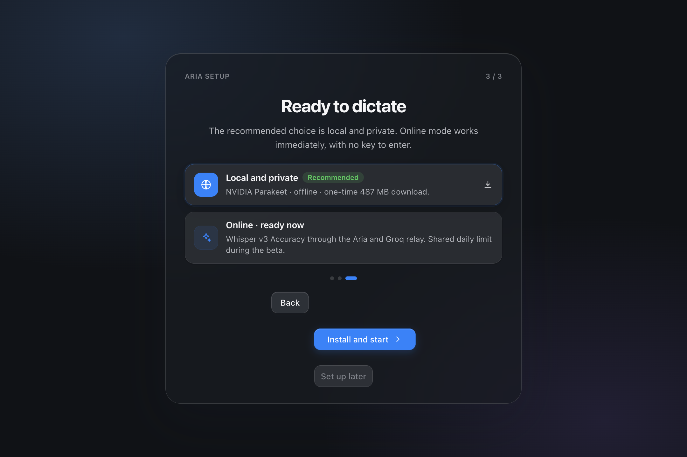

# Aria — voice dictation and speech to text for macOS

**Hold a key, speak, and the text appears in the app you are already using.** Mail, Messages,
Notes, Slack, your browser, your editor — anywhere the cursor is blinking. No separate window,
no copy and paste.

[Website](https://hfioafio.github.io/Aria-Downloads/en.html) ·
[Site français](https://hfioafio.github.io/Aria-Downloads/) ·
[Video demos (English)](https://www.youtube.com/playlist?list=PLSMVwqTInESM) ·
[Video demos (French)](https://www.youtube.com/playlist?list=PLZZLp_GlfQhs) ·
[Latest release v2.61.0](https://github.com/hfioafio/Aria-Downloads/releases/tag/v2.61.0) ·
[Report an issue](https://github.com/hfioafio/Aria-Downloads/issues/new)

Aria is a **macOS dictation app** with a **local transcription mode**. The local NVIDIA
**Parakeet TDT V3** engine processes transcription audio on your Mac. Online engines are optional.
An internet connection may still be required to verify the free quota.

It is a free download: **2,000 words per week**, resetting every Monday. **Purchasing Aria Pro
is not open yet.** Start with the free tier; the download page explains the current public beta.

The linked video introductions are animations, not screen recordings or speed benchmarks.

## Download for macOS 11 or later

| Your Mac | Download |
| --- | --- |
| Apple Silicon (M1, M2, M3, M4 and later) | [Aria-2.61.0-Apple-Silicon.dmg](https://github.com/hfioafio/Aria-Downloads/releases/download/v2.61.0/Aria-Installer-2.61.0-Apple-Silicon.dmg) |
| Intel | [Aria-2.61.0-Intel.dmg](https://github.com/hfioafio/Aria-Downloads/releases/download/v2.61.0/Aria-Installer-2.61.0-Intel.dmg) |

Checksums: [SHA-256 Apple Silicon](https://github.com/hfioafio/Aria-Downloads/releases/download/v2.61.0/Aria-Installer-2.61.0-Apple-Silicon.dmg.sha256) ·
[SHA-256 Intel](https://github.com/hfioafio/Aria-Downloads/releases/download/v2.61.0/Aria-Installer-2.61.0-Intel.dmg.sha256)

Do not mix the two builds: the Apple Silicon DMG is not meant to run under Rosetta.

## What Aria does

- **System-wide dictation.** Double-tap (or hold) the right `⌘` key, speak, and the text is typed
  at the cursor in any standard macOS text field.
- **Offline speech to text.** NVIDIA Parakeet TDT V3 runs on the Mac. No network, no upload.
- **Cloud engines, your key.** OpenAI, Groq, Deepgram, Soniox, ElevenLabs and Mistral are
  optional and use your own API key, stored encrypted in the macOS Keychain.
- **File transcription.** Drop in MP3, WAV, M4A, FLAC, OGG, MP4 or MOV and get a transcript.
- **Meeting mode with speaker identification.** Diarisation locally, or through an API if you
  prefer.
- **Faithful by default.** Aria does not summarise, translate or rewrite unless you ask. Spoken
  language is preserved: English in, English out.
- **Personal dictionary.** Correct a name or a piece of jargon once; Aria remembers it.
- **Searchable local history.** Everything stays on the device.
- **Menu bar app.** It appears on the shortcut and hands the focus straight back.

## First launch

This build carries a stable signing identity but is **not notarised by Apple yet**. After dragging
Aria into Applications:

1. Try to open it once.
2. If macOS blocks it: **System Settings → Privacy & Security → Open Anyway**.

Only do this for a file downloaded from **this repository** or from the official site.

## Updates

Aria checks this repository at launch, then every six hours. Before installing it verifies the
architecture, the size, the SHA-256 and the Apple signing identity. If the new version fails to
start, the previous one is restored automatically.

## Privacy

Personal API keys stay in the macOS Keychain. Application data stays on the Mac. With a local
model no audio is sent anywhere. With the bundled Groq mode, audio passes through a rate-limited
Aria relay to Groq and is dropped immediately; the relay stores neither audio nor text. Only
pseudonymous, bounded counters protect the shared quota.

This page and this repository carry no advertising and no third-party tracker.

---

## Français

**Parlez. Le texte s’écrit dans l’app où vous êtes.**

Aria est une application de **dictée vocale pour macOS**. Un raccourci, votre voix, et la phrase
arrive dans Mail, Messages, Notes ou n’importe quel champ de texte — pas dans une fenêtre à part
à recopier. Elle reste dans la barre des menus.

Le **mode local** (NVIDIA Parakeet TDT V3) traite l’audio de transcription sur le Mac.
Les moteurs en ligne restent facultatifs. Une connexion peut rester nécessaire pour vérifier
le quota gratuit.

**Gratuit : 2 000 mots par semaine**, remis à zéro chaque lundi. **L’achat Aria Pro n’est pas
encore ouvert.** La page de téléchargement explique les conditions de la bêta publique.

Elle transcrit aussi vos fichiers audio et vidéo, identifie les locuteurs en réunion, apprend vos
noms propres dans un dictionnaire personnel et garde un historique local consultable.

**Téléchargement :** [Apple Silicon](https://github.com/hfioafio/Aria-Downloads/releases/download/v2.61.0/Aria-Installer-2.61.0-Apple-Silicon.dmg) ·
[Intel](https://github.com/hfioafio/Aria-Downloads/releases/download/v2.61.0/Aria-Installer-2.61.0-Intel.dmg) ·
[page complète en français](https://hfioafio.github.io/Aria-Downloads/)

**Première ouverture :** cette version est signée avec une identité stable mais n’est pas encore
notarisée par Apple. Essayez de l’ouvrir une fois, puis **Réglages Système → Confidentialité et
sécurité → Ouvrir quand même**. Ne faites cette étape que pour un fichier venu de ce dépôt.

**Aide :** ouvrez une [issue](https://github.com/hfioafio/Aria-Downloads/issues/new). N’y collez
pas de clé API, de dictée, ni d’autre donnée personnelle.

---

## About this repository

The current public build is an **Electron** app for macOS 11+. This repository contains only the
compiled releases, their SHA-256 checksums and the update manifest — the source code is not
published here.

Copyright © 2026 — All rights reserved.
